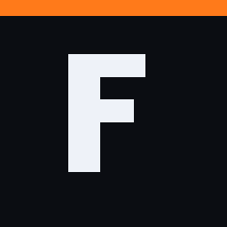

# Fruiterra Graphics Controller



Windows broadcast control for Overwatch, with OBS-compatible HTML overlays.

[](https://github.com/ThePeachZA/fruiterra-graphics-controller/actions/workflows/ci.yml)
[](#requirements)
[](LICENSE)

> [!NOTE]
> **Status: v1.0.0.** The domain model, server, overlays, all seven views and
> the packaging/release workflow are in place. Manual release gates R1–R8 are
> closed; release evidence and publication status are tracked in
> [`docs/manual-qa.md`](docs/manual-qa.md). The app is usable from source today.

## Overview

Fruiterra Graphics Controller is a Rust/Dioxus desktop application for running
an Overwatch broadcast. It manages teams, talent, matches, maps and tournaments,
and serves nine plain-HTML overlays for OBS Browser Sources at **1920×1080**.

It replaces the earlier Google Sheets-based production workflow with one
desktop application. The existing overlay WebSocket protocol is unchanged, so
overlay HTML written for the previous setup remains drop-in compatible. The
control UI is Dioxus 0.7 with a WebView2 frontend; the overlay server is Axum
on Tokio.

## Features

- **Overlay server** — start, stop and restart the server from the app, copy
  Browser Source URLs and watch the connected-client count.
- **Teams and talent** — team colours, logos, records and rosters; player roles,
  positions, portraits and featured heroes; talent profiles with an on-air role
  chosen per match assignment. Deleting a team that is still referenced is
  blocked with a full reference list.
- **Match Controller** — five tabs for match setup, maps and per-map hero bans,
  talent assignment, map pool and per-match configuration. Scores are derived
  from completed maps or entered manually, and every change is projected to the
  overlays immediately. A compact always-on widget controls the timer and hides
  its settings in an expandable panel.
- **Tournament** — single- and double-elimination brackets, round-robin groups
  with fixtures and standings, ordered tiebreakers with head-to-head,
  multi-stage group-to-playoff generation, grand-final reset, automatic
  champion detection and a bracket board with 50–150% zoom. Results and match
  details stay editable after generation; participants are arranged in the
  generation preview. Group or bracket fixtures can be pushed straight into
  the current match.
- **Assets** — a content-addressed image library with bundled and imported
  assets, deduplication by SHA-256, linked hero icons and game modes, fast
  lazy-loaded thumbnails, and project bundles for moving a setup between
  machines.
- **Settings** — overlay port, LAN access, asset URL mode, display options and
  overlay-folder overrides. Timer settings live in the floating timer widget.

## Overlays

All nine match overlays are served from the overlay server and embedded in the
executable. A standalone timer overlay is bundled as well.

| Overlay | URL |
|---|---|
| Game overlay | `/overlays/game-overlay.html` |
| Map select | `/overlays/map-select.html` |
| Hero bans | `/overlays/hero-bans.html` |
| Map pool | `/overlays/map-pool.html` |
| Home team roster | `/overlays/team-roster-home.html` |
| Away team roster | `/overlays/team-roster-away.html` |
| Casters row | `/overlays/row-casters.html` |
| Hosts and analysts row | `/overlays/row-hosts.html` |
| Interview row | `/overlays/row-interviews.html` |

The game overlay puts the team logo on the outer end of each bar and the ban
block next to the score. Match Controller → Config → Overlay appearance has a
**Team abbreviations** switch that shows the short team tag instead of the full
name; it is off by default.
| Timer (standalone) | `/overlays/timer.html` |

Add each one to OBS as a Browser Source at 1920×1080 with a transparent
background. The default base URL is `http://127.0.0.1:3001`. A third-party
overlay may pass `?port=<port>` when it connects from a different origin.

The in-app timer remains the operator control. The standalone `timer.html` is a
plain renderer: it shows the last `matchTimer` tick, applies the sent alignment
and leading-zeroes settings, and does not run its own clock. The timer settings
popup also has **Show hours**; turning it off adds the hours to the minutes, so
`01:12:00` displays as `72:00`. It is not part of the auto-overlay scene list;
add it as its own Browser Source. Third-party overlays still receive
`matchTimer` ticks and actions.

## Requirements

- Windows 10 or Windows 11, x64.
- Microsoft Edge WebView2 runtime. The installer bootstraps it when missing; a
  portable build expects it to be present.
- For source builds: Rust stable (pinned by `rust-toolchain.toml`), the MSVC C++
  build tools and Dioxus CLI 0.7.10.
- OBS Studio with one Browser Source per overlay.

## Install

Download the latest release from
[GitHub Releases](https://github.com/ThePeachZA/fruiterra-graphics-controller/releases):

- **`fruiterra-gc-<version>-windows-x64-setup.exe`** — the normal install. It
  creates a per-user Start Menu entry and uninstaller, and bootstraps WebView2
  if it is missing.
- **`fruiterra-gc-<version>-windows-x64-portable.zip`** — extract anywhere and
  run `fruiterra-gc.exe`. Nothing is installed and no registry keys are written.
  WebView2 must already be present.

Releases are unsigned in v1, so Windows SmartScreen may warn on first run.
Verify the download against `SHA256SUMS.txt` before running:

```powershell
Get-FileHash .\fruiterra-gc-<version>-windows-x64-setup.exe -Algorithm SHA256
```

The installer and portable ZIP are published with that checksum file on every
tagged release.

## Quick start

1. Launch the application.
2. Add teams and players, then talent and assets.
3. Create a match and set teams, maps, first-to and sides.
4. Start the overlay server on the default port **3001**.
5. Add the overlay URLs to OBS as Browser Sources at 1920×1080.

For a tournament, add entrants on the Tournament **Setup** tab, generate the
bracket, then use **Board** to run results and **Groups** / **Settings** for
round-robin and tiebreaker configuration.

The end-user guide covers the same flow in more detail, starting at
[`docs/wiki/Home.md`](docs/wiki/Home.md).

## Build from source

```powershell
cargo install dioxus-cli --version 0.7.10 --locked

# Development run (assets and hot reload are handled by dx)
dx serve --desktop

# Checks used by CI
cargo fmt --all --check
cargo clippy --workspace --all-targets -- -D warnings
cargo test --workspace
cargo doc --workspace --no-deps

# Packaged debug run
dx build --desktop --features bundle

# Release installer and portable app output
dx bundle --release --desktop --package-types nsis --features bundle
dx build --release --desktop --features bundle
```

The portable build is the `dx` app output, not a plain `cargo build`: the UI
assets are hashed and copied into an `assets\` folder beside the executable.
Keep that folder with `fruiterra-gc.exe`.

## Workspace layout

The dependency direction is one-way: `core` → `protocol` → `server` → `app`.

| Crate | Responsibility |
|---|---|
| `fgc-core` | Domain model, validation and repair, migrations, persistence and the tournament engine. No async runtime, Axum or Dioxus. |
| `fgc-protocol` | Wire DTOs, projection from the domain to overlay payloads, asset URL resolution and golden tests. No I/O. |
| `fgc-server` | Axum HTTP/WebSocket server, embedded overlays and bundled assets. No Dioxus. |
| `fgc-app` | Dioxus desktop shell, application state, views and the server runtime thread. |

## Data and logs

Application data, settings and the versioned save file live under:

```text
%APPDATA%\Fruiterra\Fruiterra Graphics Controller\
├── data\
│   ├── app.json
│   └── app.json.bak
├── assets\blobs\
├── overlays\
└── logs\
```

Logs are written to the `logs\` subfolder. Imported assets are stored by hash,
and a backup of the previous save is kept as `app.json.bak`.

## Documentation

| Document | Contents |
|---|---|
| [`docs/wiki/Home.md`](docs/wiki/Home.md) | End-user guide (also the source for the GitHub wiki) |
| [`docs/architecture.md`](docs/architecture.md) | Crate boundaries and design decisions |
| [`docs/data-model.md`](docs/data-model.md) | Persisted model and schema |
| [`docs/protocol.md`](docs/protocol.md) | Overlay WebSocket contract |
| [`docs/tournament.md`](docs/tournament.md) | Tournament model, generation and repair rules |
| [`docs/assets.md`](docs/assets.md) | Asset store, hashing and bundles |
| [`docs/fonts.md`](docs/fonts.md) | Font choices and licences |
| [`docs/build.md`](docs/build.md) | Packaging and release process |
| [`docs/implementation-plan.md`](docs/implementation-plan.md) | Milestones, tests and exit criteria |
| [`docs/decisions.md`](docs/decisions.md) | Decision log |
| [`docs/overlay-qa.md`](docs/overlay-qa.md) | Overlay QA checklist |
| [`docs/manual-qa.md`](docs/manual-qa.md) | Manual QA and intervention register |
| [`docs/manual-qa-runbook.md`](docs/manual-qa-runbook.md) | Step-by-step manual QA runbook |

## Network and security

- The server binds to localhost by default.
- **Allow LAN connections** binds `0.0.0.0` so other machines can load
  overlays. Access relies on a Windows Firewall rule scoped to the **Private**
  profile and the **local subnet**; set the show network to Private in Windows.
- CORS is `*` to match the original overlays.
- There is **no authentication** in v1. Use LAN mode only on a trusted network.

## Migrating from the Google Sheets workflow

There is no automatic import from the earlier Google Sheets-based workflow.
Teams, talent, matches and assets must be re-entered in the app. The new data
directory is shown above; the old spreadsheets are not read or modified.

## Known limitations

- Windows x64 only.
- No import from the earlier Google Sheets-based workflow.
- The timer is control-only; there is no bundled timer overlay.
- No bracket overlay in v1.
- Releases are unsigned, so Windows SmartScreen may warn on first run.
- No undo/redo, presets, multiple scenes, HTTP/Stream Deck API, auto-update,
  match history or custom points.

## Troubleshooting

| Symptom | Fix |
|---|---|
| SmartScreen warning | Expected for unsigned builds. Verify the published SHA-256 checksum before running. |
| "WebView2 not found" with a portable build | Install the Evergreen WebView2 runtime, or use the installer. |
| Port already in use | Change the port in Settings or stop the process using it. |
| Windows Firewall prompt in LAN mode | Allow access on private networks only, with the show network set to Private. Do not open the port to public networks. |
| Overlay stays blank | Start the overlay server and check that the Browser Source URL matches the configured port. |

## Fonts and licences

The overlays use **Archivo** and the control UI uses **Inter**. Both are
licensed under the SIL Open Font License 1.1 and are bundled locally, so neither
the overlays nor the UI make runtime font requests. **Saira** remains bundled
while the two overlay fonts are compared. The overlay families are exposed
behind the neutral `FGC Display*` aliases; see
[`docs/fonts.md`](docs/fonts.md).

Apotek is a commercial typeface and is not redistributed. The full font,
dependency and vendored-component notices are in
[`THIRD_PARTY_NOTICES.md`](THIRD_PARTY_NOTICES.md). The application is released
under the MIT licence; see [`LICENSE`](LICENSE).
